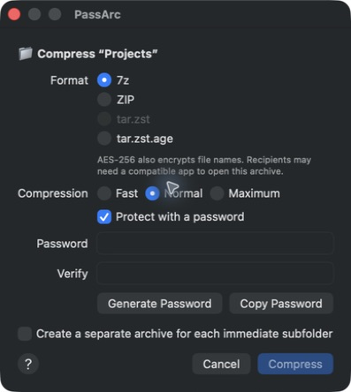
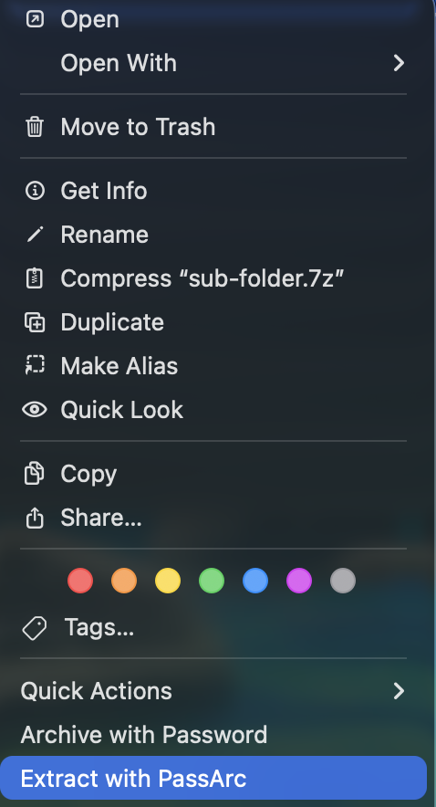

# PassArc

A small macOS app (proof of concept, for use on your own Mac) that adds **Archive with Password** to the top level
of the Finder context menu. Right-click a folder or file, choose a format, a compression level and an optional
password, and PassArc creates the archive next to the original.

- Design: [docs/superpowers/specs/2026-11-08-passarc-design.md](docs/superpowers/specs/2026-11-08-passarc-design.md)
- Implementation plan (as written before implementation): [docs/superpowers/plans/2026-11-08-passarc.md](docs/superpowers/plans/2026-11-08-passarc.md)
- Development notes (pitfalls and how the code handles them): [docs/development-notes.md](docs/development-notes.md)

## Archive a folder from Finder

1. Right-click a folder in Finder and choose **Archive with Password**.

   

2. In the **Archive** dialog, choose a format and compression level. Leave **Protect with a password** checked and enter the password in both fields, or clear it to create an unprotected archive. Click **Compress** to save the archive next to the folder.

   

## Formats

| Format | Password | Notes |
| --- | --- | --- |
| 7z | AES-256 | File names are encrypted too (`-mhe=on`). Default. |
| ZIP | AES-256 | File names are visible. The weak ZipCrypto method is never used. |
| tar.zst | none | Zstandard. Fastest. Not available while "Protect with a password" is on. |

Compression levels: Fast / Normal / Maximum (`-mx=1/5/9` for 7z and ZIP, `-1/-3/-19` for zstd).

### Comparison with macOS Finder compression

Finder’s built-in **Compress** command creates an unencrypted ZIP archive. [Apple’s Finder guide](https://support.apple.com/guide/mac-help/zip-and-unzip-files-and-folders-on-mac-mchlp2528/mac)

| Format | Performance | Security | Archive size |
| --- | --- | --- | --- |
| macOS Finder ZIP | Baseline | No encryption | Baseline |
| PassArc 7z | Higher compression settings can take longer than Finder ZIP | Optional AES-256 encryption for both file contents and names | Often smaller than Finder ZIP for text or folders with many similar files |
| PassArc ZIP | Adjustable compression level. Speed relative to Finder ZIP depends on the setting and input | Optional AES-256 encryption for file contents. File names remain visible | Typically similar to Finder ZIP, depending on the setting and input |
| PassArc tar.zst | Fast and Normal favor compression and extraction speed | No encryption | Can be smaller than Finder ZIP for text and logs. Already compressed files such as JPEGs and MP4s usually see little benefit |

The speed and size comparisons are estimates. In Zstandard’s Linux benchmark, `zstd -1` compressed about 4.9× as fast as `zlib -1`, decompressed about 4.0× as fast, and produced about 5% less compressed data. For an end-to-end comparison on macOS, include the time PassArc spends verifying the archive after creation. [Zstandard benchmark](https://github.com/meta/zstd#benchmarks) · [7z format documentation](https://www.7-zip.org/7z.html)

## Extract an archive from Finder

1. Right-click a single `7z`, `zip`, or `tar.zst` archive and choose **Extract with PassArc**.

   

2. If prompted, enter the archive password and click **Extract**. PassArc supports the AES-256 archives it creates.
3. PassArc reveals the extracted folder in Finder. The folder is created next to the archive, with a number appended if the name is already in use.

## Install with Homebrew

> [!WARNING]
> ⚠️ **The current Homebrew release is ad hoc-signed.** macOS may block PassArc the
> first time you open it. See [what to do if macOS blocks PassArc](#macos-says-passarc-was-not-opened).

On macOS 15 or later with Apple Silicon, install PassArc with Homebrew.

```sh
brew install --cask hiromaily/tap/passarc
```

Homebrew installs `PassArc.app` in `/Applications` by default and installs `sevenzip`
and `zstd`. Open PassArc once to set up its Finder Sync extension. If PassArc prompts you to enable
the extension, click **Open System Settings** and turn on **PassArcFinder**.

Right-click a test file in Finder and choose **Archive with Password**. The archive should appear
next to the original file. If macOS blocks the app or the menu item is missing, see [Troubleshooting](#troubleshooting).

### Update PassArc

If PassArc is already installed through Homebrew, run the following commands to install the latest release.

```sh
brew update
brew upgrade --cask hiromaily/tap/passarc
```

### Uninstall PassArc

```sh
brew uninstall --cask hiromaily/tap/passarc
```

For release packaging and tap updates, see the [Homebrew release guide](homebrew/README.md).

## Build and install from source

- macOS 15 or later (Apple Silicon)
- Xcode Command Line Tools (`xcode-select --install`). **Xcode itself is not needed.** It could not be installed
  on this Mac's macOS, so the app is built with `swiftc` instead (since 2026-11-08).
- Homebrew: `brew install sevenzip zstd`

7-Zip (`7zz`) is not bundled. PassArc looks for it in `/opt/homebrew/bin`, then `/usr/local/bin`. 7-Zip is licensed
under the GNU LGPL and other licenses; because it is not bundled, this repository does not redistribute it.

```sh
<this directory>/scripts/build.sh --install
```

The script compiles the app and the Finder Sync extension with `swiftc`, signs both ad hoc, copies the app to
`~/Applications/PassArc.app`, and registers the extension with `pluginkit`. The last line it prints should be a
`local.passarc.app.finder` entry starting with `+`, which means the extension is enabled.
Without `--install`, it only builds into `build/scripts/`.

## Troubleshooting

### macOS says “PassArc” was not opened

Ad hoc-signed releases can trigger this Gatekeeper warning. If you installed
through Homebrew, [check for an update](#update-passarc) first.

If you trust the copy you installed and want to open it, click **Done** in the warning. Open
**System Settings → Privacy & Security**, scroll down to **Security**, and click **Open Anyway** for
PassArc. Click **Open** when macOS asks again. If **Open Anyway** is missing, try opening PassArc again
and return to **Privacy & Security**. [Apple’s instructions for opening an app](https://support.apple.com/en-us/102445)

### “Archive with Password” is missing from Finder

1. Open PassArc from Applications. If macOS blocks it, follow the steps above first.
2. Go to **System Settings → General → Login Items & Extensions → Finder** and turn on **PassArcFinder**.
3. Open a new Finder window and right-click a file or folder. If the item is still missing, wait for any
   Finder copies or moves to finish, then hold **Option**, right-click Finder in the Dock, and choose
   **Relaunch**. If **Relaunch** is unavailable, run `killall Finder` in Terminal. macOS should start Finder again.
4. If you previously installed from source and now use Homebrew, check for a second copy in
   `~/Applications`. Move the old copy to the Trash, then open the copy in `/Applications` again.

To check the extension’s registration and see which copy macOS registered, run:

```sh
pluginkit -m -A -D -v -i local.passarc.app.finder
```

A leading `+` means the extension is enabled. If the command reports no matches, reopen PassArc and
check **Login Items & Extensions** again.

### Notifications

PassArc posts a notification when an archive is ready. Click it to reveal the file in Finder. If no notification
appears, open System Settings > Notifications > PassArc and turn on "Allow notifications".

## How it works

- The Finder Sync extension (sandboxed) only shows the menu item. It sends the selected paths to the app with a
  `passarc://archive?path=...` URL.
- The app (not sandboxed, no Dock icon) shows the dialog and runs `7zz`, or `tar` piped into `zstd`.
- The password is never passed as a command-line argument (it would be visible in `ps`). PassArc answers 7-Zip's
  "Enter password" prompt through a pseudo-terminal.
- The archive is written under a temporary `.partial` name, verified with the same password (`7zz t`, or
  `zstd -t`), and only then renamed. If you stop it, or it fails, the partial file is deleted.
- `.DS_Store` and `._*` files are left out. Symbolic links are stored as links.

## Tests

```sh
swift test --package-path <this directory>/Core
```

The tests run the real `7zz` and `zstd`, so install them with Homebrew first.

## Verification results (2026-11-08, macOS 15.7, 7-Zip 26.06)

End-to-end checks from section 7 of the design.

| # | Check | Result | How |
| --- | --- | --- | --- |
| 1 | "Archive with Password" appears at the top level of the Finder context menu | OK | Checked by hand in Finder |
| 2 | A password-protected 7z opens with the password, and file names are hidden without it | OK (7-Zip). **Not checked with The Unarchiver** (not installed) | `7zz t -phello` on an archive made from the dialog: "Everything is Ok". `7zz l` without the password: "Cannot open encrypted archive" |
| 3 | ZIP uses AES-256 | OK | Test `job_zipUsesAES256` (`Method = AES-256`). Same code path as the app, not checked from the dialog |
| 4 | tar.zst extracts to the same content | OK | Test `job_createsTarZst` |
| 5 | The password does not appear in `ps` | OK | Test `pty_createsEncrypted7zWithoutPasswordInArguments` |
| 6 | Stopping leaves no partial file | OK | Test `job_cancelRemovesPartial` (7z and tar.zst). Not checked from the dialog |
| 7 | Levels change size and time | OK | `/usr/share/man` (20 MB), same arguments as the app, table below |

| Level | 7z | tar.zst |
| --- | --- | --- |
| Fast | 7.7 MB, 0.4 s | 9.8 MB, 0.2 s |
| Normal | 5.8 MB, 5.9 s | 8.4 MB, 0.2 s |
| Maximum | 5.7 MB, 6.6 s | 6.1 MB, 7.1 s |

Also checked by hand: the dialog comes to the front, all text is in English with nothing cut off, tar.zst is greyed
out while a password is on, password messages appear when you leave a field, the **?** help, and the notification.

macOS Archive Utility could not extract a password-protected 7z made by PassArc (reported by the user), which is
why the dialog and this README point to The Unarchiver.
