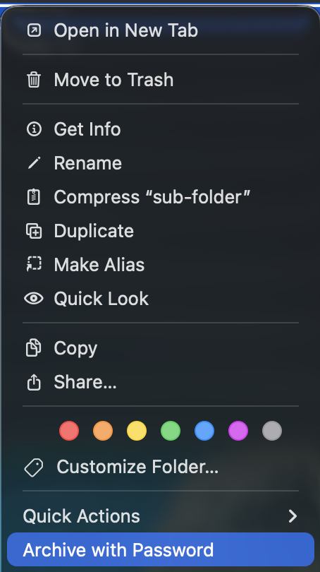

<h1 align="center">PassArc</h1>

<p align="center"><strong>Password-protected archives for macOS.</strong><br>
Right-click in Finder or drop files into PassArc. Save the archive right next to the originals.</p>

<p align="center">
  <a href="#install-with-homebrew">Install</a> ·
  <a href="#features">Features</a> ·
  <a href="#quick-start">Quick start</a> ·
  <a href="https://github.com/hiromaily/passarc/releases">Releases</a>
</p>

<p align="center"></p>

## Features

| Feature | What you can do |
| --- | --- |
| **Archive from Finder** | Right-click files or folders and choose **Archive with Password**. |
| **Drag and drop** | Drop files or folders onto the PassArc window, even with the Finder extension disabled. |
| **Encrypt with AES-256** | Protect 7z and ZIP archives with a password. Protected 7z archives also hide file names. |
| **Generate and copy passwords** | Fill both password fields with a random 24-character password and copy it to share separately. |
| **Check format compatibility** | See what the recipient will need to open the archive before you compress. |
| **Compress folders individually** | Select several folders and save a separate archive next to each one in a single run. |
| **Extract from Finder** | Open 7z, ZIP, and tar.zst archives with **Extract with PassArc**. Enter the password when prompted. |
| **Verify before saving** | PassArc verifies each archive before giving it its final name. Click the completion notification to reveal the result in Finder. |

## Install with Homebrew

PassArc requires **macOS 15 or later** on **Apple Silicon**. The cask also installs `sevenzip` and `zstd`.

```sh
brew install --cask hiromaily/tap/passarc
```

> [!NOTE]
> This README describes the features on `main`. The current Homebrew release, [v0.3.0](https://github.com/hiromaily/passarc/releases/tag/v0.3.0), includes Finder compression and extraction and password generation and copying. For the drag-and-drop window, format compatibility guidance, and separate archives for multiple folders, [build from source](#build-from-source).

The public build is ad hoc-signed. If macOS blocks the first launch, see [how to open PassArc](#macos-says-passarc-was-not-opened).

<details>
<summary>Update or uninstall with Homebrew</summary>

```sh
brew update
brew upgrade --cask hiromaily/tap/passarc
```

```sh
brew uninstall --cask hiromaily/tap/passarc
```

</details>

## Quick start

### Create an archive

1. **From Finder**, enable **PassArcFinder** in **System Settings → General → Login Items & Extensions → Finder**, then right-click files or folders and choose **Archive with Password**. **From PassArc**, open the app and drop your items onto its window.
2. Choose a format and compression level. With **Protect with a password** enabled, enter a password in both fields or click **Generate Password**. Use **Copy Password** if you need to share it separately. To select **tar.zst**, turn off password protection.
3. Click **Compress**. PassArc saves the verified archive next to the original items. To create one archive, select items from the same parent folder. To create one archive per folder, select only folders and turn on **Create a separate archive for each folder**. Any archives already saved are kept if the batch stops.

<details>
<summary>See the Finder menus</summary>

<p>
  
  
</p>

</details>

### Extract an archive

Right-click a single `.7z`, `.zip`, or `.tar.zst` file in Finder and choose **Extract with PassArc**. If prompted, enter the password and click **Extract**. PassArc creates a folder beside the archive and reveals it in Finder.

## Choose an archive format

| Format | Password protection | When to use it |
| --- | --- | --- |
| **7z** (default) | AES-256 for contents and file names | Keep file names private in a password-protected archive. |
| **ZIP** | AES-256 for contents | Choose a familiar format when the recipient has an app that supports AES-encrypted ZIP. File names stay visible. |
| **tar.zst** | Unavailable | Compress files with Zstandard when no password is needed. |

Each format offers **Fast**, **Normal**, and **Maximum** compression. Recipients who use macOS can open encrypted archives with PassArc or another compatible app such as The Unarchiver.

## Troubleshooting

### macOS says “PassArc” was not opened

If you trust the copy you installed, click **Done** in the warning, then open **System Settings → Privacy & Security** and choose **Open Anyway** for PassArc. If the option is missing, try opening PassArc again and return to **Privacy & Security**. [Apple’s instructions for opening an app](https://support.apple.com/en-us/102445)

### “Archive with Password” is missing from Finder

Open PassArc once, then confirm **PassArcFinder** is enabled under **System Settings → General → Login Items & Extensions → Finder**. Open a new Finder window and try again. If the menu is still missing, wait for current Finder operations to finish, then hold **Option**, right-click Finder in the Dock, and choose **Relaunch**.

If you have separate Homebrew and source builds installed, check which copy registered its extension with `pluginkit -m -A -D -v -i local.passarc.app.finder`. A leading `+` means the extension is enabled.

### Completion notifications are missing

Open **System Settings → Notifications → PassArc** and turn on **Allow Notifications**.

## Build from source

On Apple Silicon with macOS 15 or later, use Swift 6 and Xcode Command Line Tools with a macOS 15 or later SDK. Run these commands from the repository root.

```sh
brew install sevenzip zstd
scripts/build.sh --install
swift test --package-path Core
```

`scripts/build.sh --install` installs PassArc in `~/Applications` and registers the Finder extension. Use `scripts/build.sh` to build the app in `build/scripts/`. Core tests require Swift Testing.

PassArc keeps passwords out of saved settings, command-line arguments, and logs. Compression excludes Finder metadata files (`.DS_Store` and `._*`) and preserves symbolic links. If archiving fails or is cancelled, PassArc removes the unfinished archive.

[Development notes and build troubleshooting](docs/development-notes.md) · [Roadmap](docs/roadmap.md) · [Design](docs/superpowers/specs/2026-11-08-passarc-design.md) · [Implementation plan](docs/superpowers/plans/2026-11-08-passarc.md) · [Homebrew release guide](homebrew/README.md)
